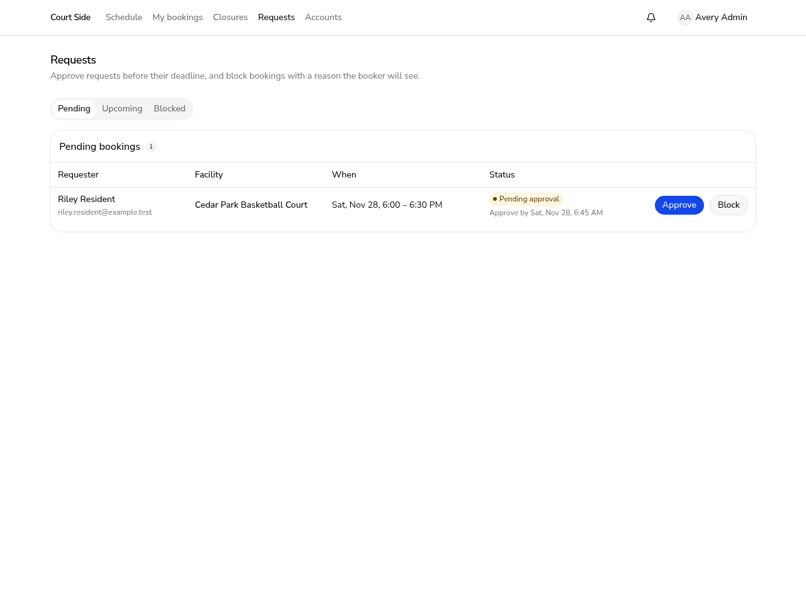
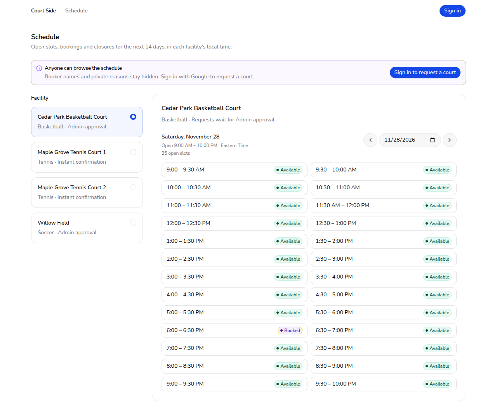
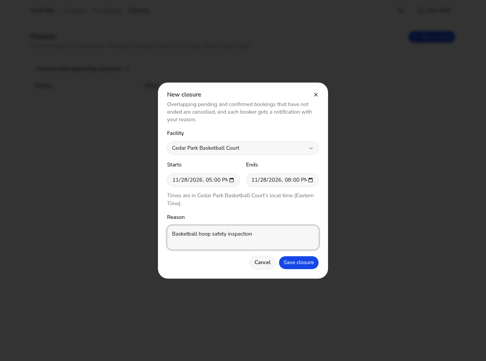
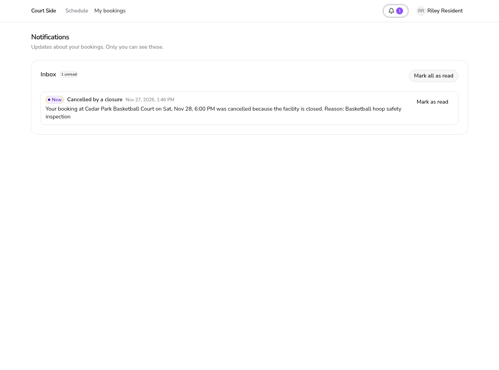

# Five-minute booking-to-closure walkthrough

Follow the [README setup](../README.md#run-locally), including the optional demo seed. Open separate browser profiles/private sessions for each role, or sign out from the account menu before switching personas. All names, email addresses and facilities below are fictional.

| Persona | Access after the demo seed |
| --- | --- |
| Riley Resident | Active Resident: request courts and view own bookings/inbox |
| Avery Admin | Active Admin: approve accounts and booking requests |
| Sam Staff | Active Facility Staff: manage maintenance closures |
| Jordan Pending | Pending account: waiting for Admin approval |
| Signed-out visitor | Public schedule only |

The demo seed puts example Booked, Pending, Event and Blocked entries on **Maple Grove Tennis Court 1 tomorrow**, and a Closed entry on Willow Creek Soccer Field. These are display fixtures, not booking or closure records in the management screens. The hold expires at its start or after 24 hours, whichever is earlier. Rerunning the demo seed moves its fixed entries to the new tomorrow; use it on a fresh demo database before creating your own reservations.

Use **Cedar Park Basketball Court** for the flow below. It requires approval and starts with no demo reservations. Pick tomorrow using the date control; screenshots captured on 27 November 2026 use 28 November. Facility time is Eastern Time (`America/Toronto`), regardless of your computer's time zone.

## 1. Request and approve a court

Sign in as Riley. On Availability, select Cedar Park Basketball Court, tomorrow, and **18:00–18:30**. Send the request. My bookings shows Pending while the time is held.

Switch to Avery and open Booking requests. Approve Riley's request; it becomes Confirmed. If starting without demo accounts, first approve Riley from Accounts. The [access verification](verification/m01-01-access.md) covers that path.

As a signed-out visitor, open the same facility and date: **18:00–18:30 is Booked**, with no resident identity or private reason.

## 2. Close the court

Switch to Sam and open Closures → New closure. Choose the same court and tomorrow, **17:00–20:00**, with reason **Basketball hoop safety inspection**. Save. The result reports one cancelled booking; the public slot becomes Closed.

## 3. Check the resident's notification

Switch back to Riley. My bookings shows Cancelled and the closure reason. Open the notification bell: the inbox contains one unread cancellation explaining the affected court, time and reason. Mark all as read clears the unread count.

To finish, Sam can end the closure. The public slot becomes Available again, while Riley's booking remains Cancelled; reopening does not silently reinstate it.

## Evidence and boundaries

These unedited screenshots come from the [integrated verification](verification/m03-01-closures.md), which created accounts and approved their roles through the application on a fresh database. The optional demo seed skips that account setup for a faster review. Screenshots show the application only and contain fictional data.

The verification also exercised keyboard booking/inbox navigation, public-data privacy, and four roles at 375, 768 and 1440px. It is not a full accessibility certification. The [booking race tests](../apps/server/test/booking-race.test.ts) cover FR-03.4; [closure tests](../apps/server/test/closures.test.ts) cover concurrent approval and closure. Google sign-in still needs the real-credential smoke test in [#4](https://github.com/Caff-Core/court-side/issues/4). Email and event-management workflows are [deferred](portfolio-scope.md).
